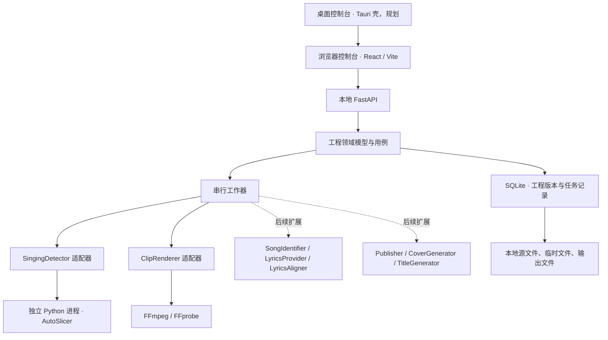

# 拾歌 · VTuber SongCut 架构

VTuber直播自动歌切工具。当前优先支持 macOS Apple Silicon，本地处理录播；浏览器控制台与桌面控制台共享业务服务。Windows、Linux 与可分发安装包按路线图验证后再宣布支持。

## 架构选择

采用模块化单体：一个 FastAPI 服务管理工程、任务和文件，一个串行工作器运行耗时步骤。模型和 FFmpeg 通过外部进程适配器调用，避免模型环境绑定 HTTP 服务依赖。早期不拆成多个网络微服务；本地工具更需要清晰接口、可重现环境与故障边界，尚无独立部署多个服务的收益。

图中虚线及桌面壳表示规划边界，不表示功能已经可用。实际完成和测试范围见根 README。

## 仓库边界

| 路径 | 职责 |
| --- | --- |
| `apps/web` | React/Vite 控制台；上传、预览、片段与字幕编辑、任务状态 |
| `apps/desktop` | 规划中的 Tauri 启动与桌面集成；复用 Web 界面 |
| `services/studio/studio/domain.py` | Pydantic 工程、片段、歌词、任务记录及不变量 |
| `services/studio/studio/ports.py` | 可替换能力的 Python Protocol |
| `services/studio/studio/adapters` | 检测器、媒体工具等具体接入 |
| `services/studio/studio/store.py` | SQLite 持久化与乐观并发控制 |
| `services/studio/studio/jobs.py` | 串行任务执行与状态管理 |
| `upstream/AutoSlicer-v2` | 独立 Git 仓库，保留上游历史与 `feat/apple-silicon` 分支 |
| `patches/0001-apple-silicon.patch` | Apple Silicon 兼容修改的可审阅补丁 |
| `var` | 默认本地运行数据；不提交素材、模型或凭据 |

接口层不得成为模型能力的依赖；适配器不导入 HTTP 层或 UI。将来更换检测模型、歌词源或发布目标，应实现相应端口，不重写时间轴与工程模型。

## 时间轴与工程数据

所有领域时间统一为**源录播绝对时间、整数毫秒**。`Clip.start_ms/end_ms`、`LyricCue` 和 `LyricWord` 均遵守此规则。渲染时才减去片段起点转换为字幕相对时间；转换 LRC、模型秒值时集中进行舍入。不得把片段相对歌词写回为源绝对时间。

`Project` 带有 `schema_version` 和 `revision`。编辑携带已有 revision，SQLite 只接受版本匹配的更新，冲突交由客户端重新读取并处理。片段 ID 唯一，起点小于终点，终点不得超过源长度。歌词词级区间有序并位于所属行内。手动微调保存元数据，不破坏源文件。`Project.source_fps` 保存探测所得真实帧率（允许未知），控制台逐帧微调用 `1000 / source_fps` 毫秒作为一步；例如 29.97 fps 不应硬编码成 25/30 fps。领域时间最终仍取整数毫秒，未知帧率须明确使用回退步长。

`Clip.original_artist` 是原唱/歌曲署名信息，`Clip.performer` 是本次直播演唱者，两者分开保存。识曲返回 `SongCandidate` 列表，包含来源、证据、可选置信度和链接；候选被人工确认前不能冒充确定答案。当前候选结构的 `artist` 仍由具体提供方解释，后续需保留提供方原始字段以免错误归一。

## 能力端口与处理链

| 端口 | 输入/输出与责任 |
| --- | --- |
| `SingingDetector` | 源文件 → 候选唱歌区间；当前接入 AutoSlicer |
| `SongIdentifier` | 音频样本 → 歌曲候选；后续接指纹、歌词等证据 |
| `LyricsProvider` | 歌曲候选 → 歌词行；只解决歌词来源 |
| `LyricsAligner` | 音频、已知文本、源偏移 → 带时间歌词；只解决对齐 |
| `ClipRenderer` | 工程与片段 → MP4、MP3 等输出 |
| `CoverGenerator` | 工程与片段 → 封面图片；独立扩展 |
| `TitleGenerator` | 片段 → 标题候选；独立扩展 |
| `Publisher` | 文件、元数据、幂等键 → 远端结果；B 站和音乐网站分别适配 |

主链路为导入素材 → 媒体探测/预览 → 唱歌检测 → 人工校正 → 歌曲与歌词校正 → 字幕渲染 → 导出。当前原型以本地 LRC 和人工元数据为主。自动识曲、歌词检索、本地 ASR、强制对齐是不同能力，不因存在端口而视为已经实现。本地 ASR 后续应增加明确的转录端口，不把听写隐藏到歌词检索接口里。

媒体适配器默认使用 imageio-ffmpeg 随包 FFmpeg（当前构建含 libass），允许通过 `SONGCUT_FFMPEG` 覆盖；FFprobe 仍默认从 PATH 查找，可用 `SONGCUT_FFPROBE` 指定。实际字幕烧录能力仍通过运行时能力探测确认。

字幕支持单行、经典双行与左右 KTV 布局。只有 `LyricCue.words` 有真实词级时间时才生成逐词推进；只有 LRC 行时间时只能行级显示/高亮，不通过平均分配字符时长伪装精确卡拉 OK。渲染产物可以重新生成，工程数据是编辑事实来源。

编码参数属于每个 `Clip.export_settings`，随工程保存；包括视频/音频输出开关、H.264/HEVC、源尺寸/720p/1080p/2160p、保留或指定帧率、CRF 质量模式或目标视频码率、MP3 音频码率。至少启用一种输出。导出任务使用提交时的工程快照与输入 revision，后续编辑不会悄悄改变已排队任务的编码设置。所选码率是编码器目标值，不能据此承诺最终文件精确大小。

## 任务与失败处理

`Job` 持久化 `queued/running/succeeded/failed/interrupted` 状态、输入工程版本 `input_revision`、消息和产物路径。单工作器限制同时运行的重任务，降低统一内存争用。子进程退出、无效检测输出、缺失 FFmpeg/检查点均应转为可见错误，不能返回空结果伪装成功。

**任务记录持久化不等于可靠队列。** 当前不宣称崩溃后自动重派、从中间步骤续跑或恰好一次执行。后续需要任务认领/租约、启动时清理运行状态、可重入步骤、临时输出原子替换、取消与进程终止。对外发布另需幂等与状态核对，不能盲目重试上传。

检测与渲染需记录其输入工程版本；后台任务完成时若工程已变化，必须避免覆盖新编辑。该行为是验收项目，完成情况以实际实现和测试为准。

## 设备、桌面与部署边界

设备选择应显式支持 `auto/mps/cpu/cuda`，先探测可用性再启动；MPS 不支持的操作应有清楚报错或经验证的回退路径。HTTP 服务与模型 Python 可分别配置，减少 PyTorch 环境冲突。Apple Silicon 优先走原生 arm64 Python，训练、推理、评估与特征缓存分别验证。

Tauri 负责服务生命周期、端口冲突、退出清理和桌面权限；仅放一个 WebView 不构成可用桌面发行版。Python、模型、FFmpeg、字体的打包、签名与更新仍需独立验收。浏览器模式默认面向本机；跨设备访问前必须增加认证、来源限制、路径隔离和上传配额。

## 两个工作区与主播训练

默认工作区是录播切歌，训练通过独立入口打开。两个工作区保留各自的本次页面会话草稿；隐藏的切歌工作区不响应播放/切点快捷键。模型选择旁的帮助可跳到训练或 FAQ。模型管理、已有模型导入和素材标注只在训练工作区显示。

`training.py` 持久化训练数据集、素材、标注、用途、复核状态和训练任务。训练集与验证集按独立录播划分；完全相同的素材不允许重复导入，重编码或切分后的同场素材仍需用户自行避免泄漏。确认完整复核后，未标注区间成为非目标演唱；目标演唱标为 1，其余为 0。初版使用原模型的二分类 CRNN 路线，避免沿用旧脚本中写死的阿梓目录与标注假设。

`training_worker.py` 在独立模型 Python 中校验素材哈希，生成 log-mel 缓存、标签和绝对路径清单，调用原 `src/train.py`。任务使用数据集/训练设置快照；之后修改标注不会改变已提交任务。进度来自实际准备阶段、训练输出与验证历史。成功需要真正生成有限值权重；取消会清理所拥有的训练进程组。重启只标记中断并清理能够核实归属的训练进程，不声称自动续训。既有检测子进程在强制杀死服务后尚无同等级进程恢复清理。

`model_library.py` 将兼容检查点校验后复制到按 SHA-256 命名的受管模型目录。校验在模型解释器的独立进程运行，使用 weights-only 加载，检查结构、有限值、输出类别与时间降采样比例。来源区分预配置、导入和自行训练；不从权重猜测演唱者身份。模型不会随项目训练素材或原始检查点删除而消失。

切歌项目保存 `detector_model_id` 和 `detector_device`，没有模型选择时不能自动检测。训练成功的模型可一键带回切歌；尚未导入录播时保留待使用模型。检测任务记录实际模型 ID、名称、哈希及解析后的设备。API 对训练与检测做互斥检查，避免正常请求同时占用同一计算设备；视频导出仍使用独立媒体处理路径。
