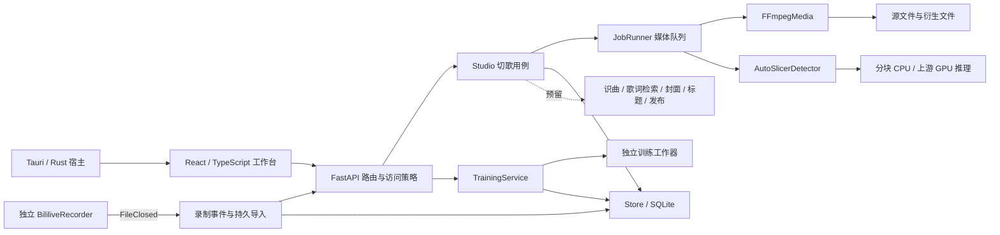

# 拾歌 · VTuber SongCut 当前架构

本说明于2026-10-29按 `333104d` 源码核对。更细的功能→组件→文件/符号/行号映射见[交互架构地图](architecture/README.md)。它是独立静态文档，不改变业务实现。

## 总体结构

当前是 **React + TypeScript + FastAPI/Python + SQLite**，桌面由 **Tauri/Rust** 承载同一网页。录制器 **BililiveRecorder** 是独立外部服务，媒体工具和模型计算通过子进程执行。前端没有Vue；未来若换视图框架，应复用独立TS应用逻辑，而不是复制业务流程。

这是模块化单体，不是所有模块都拆成网络微服务。图中两条计算路径必须区分：媒体任务由JobRunner管理，训练由TrainingService自己的工作器管理；低配服务器关闭训练。

## 代码边界

| 层 | 当前实现 |
| --- | --- |
| UI与前端交互 | `apps/web/src`；App、TrainingWorkspace等视图仍混有状态与流程编排 |
| 可复用TS规则 | `editing.ts`、`playback.ts`、`polling.ts`、外观控制器；`api.ts`仍混合DTO、会话、HTTP和上传 |
| HTTP与组装 | `api.py`集中装配服务和多数路由；`recording_api.py`已独立为APIRouter |
| 领域与应用 | `domain.py`约束记录；Studio组织切歌用例；TrainingService、ModelLibrary、RecorderService各有职责 |
| 调度与保护 | JobRunner、ResourcePolicy、RequestLimits、execution、WorkspaceLease |
| 持久化 | Store提供SQLite连接及项目/任务操作；训练、模型、录播等仍通过同一连接直接执行自己的SQL |
| 具体适配 | FFmpegMedia、AutoSlicerDetector、RecorderClient；模型验证与训练/推理worker隔离执行 |
| 桌面与交付 | Tauri宿主、PyInstaller后端、Docker/Compose、发行工作流与第三方媒体构建 |

模型、源码克隆和用户数据不混入前端；`var/`及系统应用数据目录不提交到Git。外部上游源码由固定来源清单和兼容补丁取得。

## 关键数据规则

- 项目、片段、歌词使用源录播绝对时间、整数毫秒。导出字幕时才转换到片段相对时间。
- Project/DataSet使用revision避免静默覆盖。预览元数据更新不增加编辑revision，前端只合并媒体字段，不覆盖未保存草稿。
- 共享原片与个人剪辑分开。克隆项目复用源文件和预览，各自保存owner、片段、字幕与导出快照。
- 快速导出受关键帧影响；精确导出可以重编码和烧录字幕，均从原始素材读取。
- 只有真实逐词时间才启用精确逐词效果；本地LRC解析不等于自动歌词检索或对齐。
- 模型库通过SHA-256管理权重。媒体源签名当前采用路径、大小和mtime，原始归档必须保持不可变。

## 任务与运行方式

结构化媒体任务保存输入、模型信息和快照，按用户轮换、总量和用户配额排队，支持取消、截止时间与重启后重新处理；旧的闭包型任务不能自动恢复。模型或原片变化时拒绝写入旧结果。训练任务有独立的快照、准备度校验、进度和进程清理机制。

本地正常模式保留训练；Linux低配模式使用CPU推理、限制线程/连接/上传/磁盘/导出。默认320p为共享播放副本，高清按需准备，模型仍读取源音频。CPU分块处理不等于已完成弱Linux长录播性能验证。

桌面壳已实现后端生命周期、端口冲突处理和自己的进程关闭；网页与桌面共享业务。当前源码功能不自动进入旧Releases，安装、签名与平台验收仍是独立交付步骤。

## 尚未接通的能力

`ports.py`中预留了SongIdentifier、LyricsProvider、LyricsAligner、CoverGenerator、TitleGenerator、Publisher。自动歌名/原唱识别、歌词检索/对齐、AI封面/标题、B站/音乐网站自动发布仍没有完整实现；B站录制接入不等于自动投稿。

SingingDetector已有实际适配器，ClipRenderer有对应媒体实现，但部分应用用例仍直接依赖具体类，尚未形成完整的可替换提供方体系。

## 重构方向

1. 先补齐明确响应DTO与契约生成：静态OpenAPI为32个HTTP操作，当前源码45个，且动态dict返回字段无法仅靠旧快照自动生成TS。
2. 将App、训练与预览中的有状态流程迁入独立TS服务类，例如EditorSession、PreviewCoordinator、TrainingController、SessionManager；组件只做渲染、状态绑定和操作转发。
3. 保留时间码、帧网格、校验和歌词转换等纯函数。增加类应改善状态归属、依赖注入和生命周期，而不是增加无意义的static包装。
4. 拆HTTP路由和组合入口，收敛Repository，给持久任务描述增加明确类型及版本。
5. 统一应用版本、平台依赖清单和开发服务地址。当前Vite代理仍固定8765，应与可配置端口解耦。

这些是规划，不表示本次已经执行重构。具体优先级、代码入口和验收判据可在架构网页中查看并导出。
